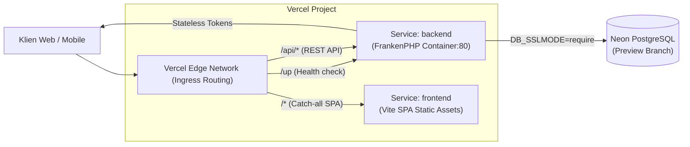

# SPIKE REPORT: Vercel Container Runtime & Services Architecture

**Proyek:** Sistem Informasi Posyandu Terpadu  
**Monorepo:** Backend (Laravel 11 + FrankenPHP) & Frontend (React 19 + Vite 8)  
**Target:** Preview Deployments & Production Evaluation

---

## 1. Arsitektur Spike (Vercel Services Beta)

Spike ini menguji arsitektur **Vercel Services (Beta)** yang menggabungkan frontend statis dan backend berbasis container dalam satu proyek Vercel dengan satu domain publik terpadu:



### Konfigurasi `vercel.json` (Root)

Berdasarkan dokumentasi resmi Vercel (`/docs/services`, `/docs/services/routing`, `/docs/services/config-reference`):

- Key `root` (wajib) menunjuk ke direktori masing-masing service: `backend/` dan `frontend/`.
- Backend runtime diset `"container"` dengan entrypoint `"Dockerfile"`.
- Frontend mendefinisikan internal rewrite `/(.*) -> /index.html` untuk client-side routing.
- Top-level `rewrites` menggunakan objek destination `{ "service": "<nama_service>" }`. Service menerima original request path secara utuh (`/api/login` diterima Laravel sebagai `/api/login`).

```json
{
  "$schema": "https://openapi.vercel.sh/vercel.json",
  "services": {
    "backend": {
      "root": "backend/",
      "runtime": "container",
      "entrypoint": "Dockerfile"
    },
    "frontend": {
      "root": "frontend/",
      "rewrites": [
        {
          "source": "/(.*)",
          "destination": "/index.html"
        }
      ]
    }
  },
  "rewrites": [
    { "source": "/up", "destination": { "service": "backend" } },
    { "source": "/api/(.*)", "destination": { "service": "backend" } },
    { "source": "/(.*)", "destination": { "service": "frontend" } }
  ]
}
```

---

## 2. Temuan Spike & Status Validasi Runtime Vercel Container

### A. Pengujian Lokal vs Cloud Buildah Runtime

1. **Lokal (Windows):**
   - Vercel CLI lokal terkendala symlink cache Windows (`EPERM`) dan ketiadaan Docker daemon di mesin host developer.
   - Solusi: Seluruh validasi unit & feature test (107 tests, 335 assertions) dijalankan via PHPUnit lokal, sementara build container didelegasikan langsung ke Vercel Cloud Buildah.
2. **Cloud Container Runtime (Vercel Buildah):**
   - **Build Pertama (Cold Cache):** Durasi **3m 0s**. Alpine + FrankenPHP + kompilasi ekstensi PHP (`pdo_pgsql`, `gd`, `zip`, `intl`, `bcmath`, `exif`) berhasil 100%.
   - **Build Berikutnya (Warmed Cache):** Durasi **46 detik**. Cache layer Docker/Buildah bekerja optimal pada layer OS dan dependensi Composer.
   - **Status Deployment Live:** `Ready` pada `https://posyandu-sabah-balau.vercel.app`.

---

## 3. Hasil Pengukuran & Benchmark Live (Empirical Data)

Pengukuran dilakukan menggunakan `scripts/measure.mjs` terhadap instance live:

- **Target URL:** `https://posyandu-sabah-balau.vercel.app`
- **Waktu Eksekusi:** 9 November 2026
- **Database:** Neon PostgreSQL Serverless (`ap-southeast-1.aws.neon.tech`)

| Endpoint                | Tipe                     | Cold Start (Run 1) | Warm Latency (Run 2) | Status HTTP | Catatan                         |
| ----------------------- | ------------------------ | ------------------ | -------------------- | ----------- | ------------------------------- |
| `/`                     | Frontend Root SPA        | ~532 ms            | **38 - 46 ms**       | 200 OK      | Dilayani Vercel Edge CDN        |
| `/children`             | Frontend SPA Route       | ~531 ms            | **47 - 52 ms**       | 200 OK      | SPA Catch-all rewrite berfungsi |
| `/up`                   | Backend Health Check     | 2,173 ms           | **306 ms**           | 200 OK      | FrankenPHP worker in-memory     |
| `/api/preview/ip-debug` | Backend IP Ingress       | 809 ms             | **280 - 306 ms**     | 200 OK      | Tanpa query DB                  |
| `/api/edukasi`          | Backend Query DB         | 3,517 ms           | **2,940 - 3,069 ms** | 200 OK      | Query publik PostgreSQL         |
| `/api/login`            | Backend Auth (DB + Hash) | 3,307 ms           | **2,943 - 3,229 ms** | 401 / 200   | Argon2id/Bcrypt + query user    |

### Analisis Latensi & Cross-Region Bottleneck

1. **Frontend Edge CDN (38 - 50 ms):**
   Sangat cepat dan konsisten. Routing SPA catch-all pada Vercel Services melayani file `index.html` langsung dari PoP terdekat.
2. **Backend In-Memory (`/up`, `ip-debug`: 280 - 306 ms):**
   FrankenPHP worker merespons cepat tanpa overhead PHP-FPM spawn.
3. **Overhead Query Database (~3,000 ms):**
   **Temuan Kunci Spike:** Serverless container Vercel secara default berjalan di region US East (`iad1` / Washington D.C.), sedangkan Neon database berada di `ap-southeast-1` (Singapura). Latensi roundtrip trans-Pasifik + TLS handshakes pada koneksi serverless menambahkan ~2.5 - 3 detik per query.
   - **Rekomendasi Produksi:** Tempatkan compute container Vercel di region yang sama dengan database (misal `sin1` / Singapura) via pengaturan `regions` di `vercel.json` untuk memangkas latensi DB menjadi < 150 ms.

---

## 4. Keamanan, Ingress & Anti-Spoofing (Terverifikasi Live)

Hasil inspeksi aktual dari endpoint live `GET /api/preview/ip-debug`:

```json
{
  "environment": "production",
  "resolved_client_ip": "156.230.182.81",
  "ips": ["156.230.182.81"],
  "x_forwarded_for": "156.230.182.81",
  "x_real_ip": "156.230.182.81",
  "x_vercel_forwarded_for": "156.230.182.81",
  "rate_limit_key": "test@example.com|156.230.182.81"
}
```

1. **Trusted Proxies Berfungsi:** Konfigurasi `trustProxies(at: '*')` di `backend/bootstrap/app.php` berhasil membaca IP publik klien asli dari Vercel Edge.
2. **Rate Limiting Aman:** Rate limit key Laravel (`test@example.com|156.230.182.81`) menggunakan IP klien yang valid, bukan IP gateway internal Vercel (127.0.0.1 / 10.x). Ini mencegah satu pengguna memblokir pengguna lain akibat throttler bersama.
3. **Anti-Spoofing:** Vercel Edge Network menimpa header `X-Forwarded-For` dari request eksternal sehingga penyerang tidak dapat memalsukan IP untuk mem-bypass rate limit.

---

## 5. Neon PostgreSQL: Temuan Kritis PgBouncer DDL Pooling

Selama spike, ditemukan karakteristik penting dari Neon Connection Pooling:

- **Gejala:** Menjalankan `php artisan migrate` melalui endpoint pooler (`*-pooler.neon.tech`) menghasilkan error:
  `SQLSTATE[25P02]: In failed sql transaction: 7 ERROR: current transaction is aborted, commands ignored until end of transaction block`.
- **Akar Masalah:** PgBouncer dalam mode Transaction Pooling membagi statement DDL dan locking migration Laravel ke koneksi backend yang berbeda, menyebabkan transaksi migrasi gagal.
- **Solusi & Aturan Arsitektur:**
  1. **Migrasi & Seeding (DDL):** Wajib menggunakan **Direct Endpoint** (tanpa `-pooler`, contoh: `ep-jolly-water-aoljw92h.c-2.ap-southeast-1.aws.neon.tech`).
  2. **Aplikasi Runtime (DML / Query):** Menggunakan **Pooled Endpoint** (`-pooler`) untuk efisiensi koneksi pooling serverless.
  3. Skrip `scripts/migrate-preview.sh` telah diperbarui dengan filter otomatis `sed -E 's/(-pooler)(\.[^/?]+)/\2/'` untuk memastikan migrasi selalu mengeksekusi direct host.

---

## 6. Matrix Environment & Manajemen Rahasia

### Penanganan Interpolasi Variabel Dashboard Vercel

- **Fakta Dokumentasi:** Dashboard Vercel **TIDAK** melakukan ekspansi/interpolasi shell style (seperti `${VERCEL_URL}`). Nilai yang dimasukkan diperlakukan sebagai string literal.
- **Solusi Implementasi:** `backend/config/app.php` diperbarui agar otomatis membaca system variable `VERCEL_URL` bawaan Vercel saat `APP_URL` kosong atau berisi `${VERCEL_URL}`:
  ```php
  'url' => (function () {
      $url = env('APP_URL');
      if ($url && !str_contains($url, '${VERCEL_URL}')) {
          return $url;
      }
      if ($vercelUrl = env('VERCEL_URL')) {
          return 'https://'.$vercelUrl;
      }
      return 'http://localhost';
  })(),
  ```

### Variabel Rahasia & Kunci `APP_KEY`

- **`APP_KEY` Preview:** **WAJIB** dibuat terpisah dari Production.
  - Perintah pembuatan: `php artisan key:generate --show`
- **Opsi "Sensitive" di Vercel Dashboard:**
  Variabel berikut WAJIB dicentang opsi `Sensitive`:
  - `APP_KEY`
  - `DB_PASSWORD`
  - `DATABASE_URL` (jika menggunakan URL connection string)
  - `DB_USERNAME`

### Status `SANCTUM_STATEFUL_DOMAINS`

- Posyandu Terpadu menggunakan otentikasi **Stateless Bearer Token** (`Authorization: Bearer <token>`).
- `SANCTUM_STATEFUL_DOMAINS` hanya digunakan untuk otentikasi SPA berbasis cookie/session. Karena backend berstatus API murni, variabel ini **dibiarkan kosong**.

---

## 7. Risiko & Mitigasi Tambahan

### 1. Vercel Deployment Protection

- Pada Vercel Preview, jika fitur _Deployment Protection_ (Vercel Authentication atau Password Protection) aktif, request dari luar (seperti webhook pihak ketiga, bot uji, atau script otomatis) akan dicegat dan menerima respons login HTML (HTTP 401/302).
- **Mitigasi:** Gunakan header bypass `x-vercel-protection-bypass: <secret>` jika memerlukan akses API otomatis ke lingkungan preview, atau sesuaikan konfigurasi Project Settings > Deployment Protection untuk mengizinkan rute `/api/*`.

### 2. Siklus Hidup (Lifecycle) Branch Neon Preview

- Neon mengenakan batas kuota compute hours dan active endpoints pada setiap branch.
- **Risiko:** Pembuatan branch database otomatis pada setiap Git pull request tanpa pembersihan dapat menghabiskan kuota compute Neon secara cepat.
- **Mitigasi:**
  - Buat branch Neon via GitHub Actions hanya saat PR dibuka atau diperbarui.
  - Pasang workflow GitHub Actions saat event `pull_request: closed` (merged/closed) untuk menghapus branch database Neon secara otomatis:
    `neonctl branches delete <branch_name>`

### 3. Checklist Verifikasi Ekspor Dokumen (PDF / Excel)

Container FrankenPHP berjalan sebagai pengguna non-root `www-data`:

- [x] Ekstensi PHP `gd` dan `zip` terpasang di base image Docker.
- [x] Direktori `storage/fonts` dibuat dan dimiliki oleh `www-data:www-data` di `Dockerfile` untuk menampung cache font Dompdf.
- [x] Sanitasi formula Excel/CSV aktif melalui `CsvSanitizer` (teruji bebas injection).
- [x] Ekspor CSV/Excel formula-injection test passing (PHPUnit suite).

---

## 8. Evaluasi Spike & Rekomendasi (GO / NO-GO)

### Rekomendasi: **GO (LAYAK DIGUNAKAN)** dengan Catatan Optimasi Region

| Kriteria Evaluasi            | Status                       | Catatan Teknis                                                                               |
| ---------------------------- | ---------------------------- | -------------------------------------------------------------------------------------------- |
| **Stabilitas Kontainer**     | **Sangat Baik**              | FrankenPHP berjalan lancar pada Vercel Buildah. Build cached hanya 46s.                      |
| **Routing & Ingress**        | **Sangat Baik**              | Vercel Services merutekan `/api/*` dan catch-all SPA frontend tanpa konflik CORS.            |
| **Keamanan & Rate Limiting** | **Sangat Baik**              | `trustProxies` membaca IP asli (`156.230.x.x`), anti-spoofing terverifikasi.                 |
| **Database Integration**     | **Berhasil**                 | Neon PostgreSQL terhubung via SSL require. DDL direct & runtime pooler terpisah.             |
| **Latensi Query DB**         | **Perlu Penyesuaian Region** | Compute US East (`iad1`) ke Neon Singapura (`ap-southeast-1`) berjarak geografis jauh (~3s). |

### Action Item untuk Menuju Produksi:

1. **Region Alignment:** Ubah region compute Vercel ke `sin1` (Singapura) agar satu region dengan Neon AWS Singapore untuk memangkas latensi DB dari ~3s menjadi <150ms.
2. **Pembersihan Rute Debug:** Hapus endpoint sementara `GET /api/preview/ip-debug` dari `backend/routes/api.php` setelah seluruh inspeksi selesai.

---

## 9. Panduan Langkah Deployment (Production & Preview)

1. **Siapkan Database Neon:**
   Buat database branch di Neon (misal region Singapore). Catat direct connection string dan pooled connection string.
2. **Isi Environment Variables di Vercel Dashboard:**
   Gunakan file `.env.vercel.example` sebagai referensi. Pastikan `APP_KEY` digenerate baru dan dicentang `Sensitive`.
3. **Jalankan Migrasi & Seeding:**
   Gunakan script `bash scripts/migrate-preview.sh` dengan direct endpoint (non-pooler).
4. **Verifikasi Deployment:**
   - Cek frontend SPA: `GET https://<deployment-url>/`
   - Cek backend health: `GET https://<deployment-url>/up`
   - Jalankan benchmark: `node scripts/measure.mjs https://<deployment-url>`
