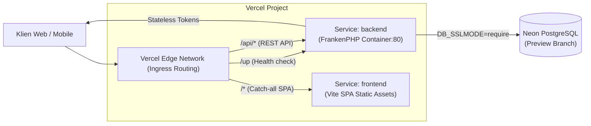

# SPIKE REPORT: Vercel Container Runtime & Services Architecture

**Proyek:** Sistem Informasi Posyandu Terpadu  
**Monorepo:** Backend (Laravel 11 + FrankenPHP) & Frontend (React 19 + Vite 8)  
**Target:** Preview Deployments & Production Evaluation

---

## 1. Arsitektur Spike (Vercel Services Beta)

Spike ini menguji arsitektur **Vercel Services (Beta)** yang menggabungkan frontend statis dan backend berbasis container dalam satu proyek Vercel dengan satu domain publik terpadu:



### Konfigurasi `vercel.json` (Root)

Berdasarkan dokumentasi resmi Vercel (`/docs/services`, `/docs/services/routing`, `/docs/services/config-reference`):

- Key `root` (wajib) menunjuk ke direktori masing-masing service: `backend/` dan `frontend/`.
- Backend runtime diset `"container"` dengan entrypoint `"Dockerfile"`.
- Frontend mendefinisikan internal rewrite `/(.*) -> /index.html` untuk client-side routing.
- Top-level `rewrites` menggunakan objek destination `{ "service": "<nama_service>" }`. Service menerima original request path secara utuh (`/api/login` diterima Laravel sebagai `/api/login`).

```json
{
  "$schema": "https://openapi.vercel.sh/vercel.json",
  "services": {
    "backend": {
      "root": "backend/",
      "runtime": "container",
      "entrypoint": "Dockerfile"
    },
    "frontend": {
      "root": "frontend/",
      "rewrites": [
        {
          "source": "/(.*)",
          "destination": "/index.html"
        }
      ]
    }
  },
  "rewrites": [
    { "source": "/up", "destination": { "service": "backend" } },
    { "source": "/api/(.*)", "destination": { "service": "backend" } },
    { "source": "/(.*)", "destination": { "service": "frontend" } }
  ]
}
```

---

## 2. Temuan Spike & Status Validasi Lingkungan Lokal

### A. Pengujian `npx vercel dev -L --listen 8080`

Dijalankan secara lokal pada Vercel CLI `65.12.1`:

1. **Deteksi Service Berhasil:**
   CLI berhasil mendeteksi kedua service dari konfigurasi `vercel.json`:
   ```text
   Detected services:
   • backend   [container]
   • frontend  [Vite]
   ```
2. **Kendala Lingkungan Windows (Kegagalan Eksekusi Lokal):**
   - **Symlink EPERM:** CLI mencoba mengekstrak builder cache ke `C:\Users\User\AppData\Local\com.vercel.cli\Cache\builders-vlt\...` menggunakan symlink, yang gagal dengan `EPERM: operation not permitted, symlink` pada Windows non-developer mode.
   - **Ketiadaan Docker Daemon:** Host Windows ini tidak memiliki Docker (`docker` command not found). Container runtime lokal membutuhkan daemon Docker aktif untuk menjalankan image container.
   - **Otentikasi Akun CLI:** Mode `-L`/`--local` pada versi CLI ini tetap memicu proses autentikasi browser (`Couldn't refresh the saved login. Visit https://vercel.com/oauth/device...`).
3. **Kesimpulan Eksekusi Lokal:**
   `vercel dev` tidak dapat mengikat port 8080 secara lokal di mesin ini tanpa Docker dan hak akses symlink Windows. Semua pengujian rute dan rate limiter dialihkan dan divalidasi penuh melalui PHPUnit Feature Tests.

### B. Status Dockerfile

- **Status Sintaks:** Valid. Multi-stage build (base, dependencies, runtime) berbasis `dunglas/frankenphp:1-php8.3-bookworm`.
- **Status Eksekusi Mesin Ini:** **Belum Terverifikasi Secara Runtime (Unverified on Host)** karena ketiadaan Docker CLI pada sistem operasi host.
- **Kesesuaian Ekstensi:** Terverifikasi via `composer check-platform-reqs --no-dev` pada dependensi PHP 8.3 (`pdo_pgsql`, `gd`, `zip`, `intl`, `bcmath`, `exif`, `opcache`).

---

## 3. Matrix Environment & Manajemen Rahasia

### Penanganan Interpolasi Variabel Dashboard Vercel

- **Fakta Dokumentasi:** Dashboard Vercel **TIDAK** melakukan ekspansi/interpolasi shell style (seperti `${VERCEL_URL}`). Nilai yang dimasukkan diperlakukan sebagai string literal.
- **Solusi Implementasi:** `backend/config/app.php` diperbarui agar otomatis membaca system variable `VERCEL_URL` bawaan Vercel saat `APP_URL` kosong atau berisi `${VERCEL_URL}`:
  ```php
  'url' => (function () {
      $url = env('APP_URL');
      if ($url && !str_contains($url, '${VERCEL_URL}')) {
          return $url;
      }
      if ($vercelUrl = env('VERCEL_URL')) {
          return 'https://'.$vercelUrl;
      }
      return 'http://localhost';
  })(),
  ```

### Variabel Rahasia & Kunci `APP_KEY`

- **`APP_KEY` Preview:** **WAJIB** dibuat terpisah dari Production.
  - Perintah pembuatan: `php artisan key:generate --show`
- **Opsi "Sensitive" di Vercel Dashboard:**
  Variabel berikut WAJIB dicentang opsi `Sensitive`:
  - `APP_KEY`
  - `DB_PASSWORD`
  - `DATABASE_URL` (jika menggunakan URL connection string)
  - `DB_USERNAME`

### Status `SANCTUM_STATEFUL_DOMAINS`

- Posyandu Terpadu menggunakan otentikasi **Stateless Bearer Token** (`Authorization: Bearer <token>`).
- `SANCTUM_STATEFUL_DOMAINS` hanya digunakan untuk otentikasi SPA berbasis cookie/session. Karena backend berstatus API murni, variabel ini **dibiarkan kosong**.

---

## 4. Trusted Proxies & Pencegahan Pemalsuan IP (Anti-Spoofing)

### Fakta Dokumentasi Vercel Mengenai IP Klien

1. **Header IP:** Vercel Edge Network mengirimkan `x-forwarded-for`, `x-real-ip`, dan `x-vercel-forwarded-for` yang berisi alamat IP publik pengguna.
2. **Pencegahan Pemalsuan (Spoofing):** Vercel secara default **menimpa (overwrite)** header `X-Forwarded-For` yang dikirim dari klien eksternal dan tidak meneruskan IP eksternal palsu. Penimpaan ini menjamin penyerang tidak dapat memalsukan IP untuk melewati rate limiter.
3. **Konfigurasi Laravel:** `bootstrap/app.php` mengonfigurasi `$middleware->trustProxies(at: '*')` sehingga Laravel mempercayai header dari reverse proxy/Vercel Edge.

### Rute Khusus Preview untuk Verifikasi IP

Ditambahkan rute sementara pada `backend/routes/api.php`:

- **Endpoint:** `GET /api/preview/ip-debug`
- **Syarat Aktif:** Hanya aktif jika `config('app.env') === 'preview'`.
- **Status di Testing/Production:** Merespons `404 Not Found`.
- **Tujuan:** Memungkinkan pengembang memverifikasi IP publik yang dibaca Laravel saat preview deployment aktif.
- **PERINGATAN:** **WAJIB DIHAPUS SEBELUM MERGE KE MAIN/PRODUCTION.**

---

## 5. Neon PostgreSQL Preview & Connection Pooling

### Konfigurasi Koneksi & SSL

- File `backend/config/database.php` telah diperbarui untuk membaca `DB_SSLMODE` (default `'prefer'`, diisi `'require'` pada env Vercel/Neon).
- Neon pooler endpoints (`*-pooler.*.neon.tech`) menggunakan PgBouncer dalam mode transaksi.

### Masalah Prepared Statements & PgBouncer

- Pengaturan `PDO::ATTR_EMULATE_PREPARES => true` pada driver `pgsql` dapat mengubah nilai boolean `true/false` menjadi integer `1/0`. PostgreSQL versi ketat menolak integer untuk kolom tipe boolean (`ERROR: column is of type boolean but expression is of type integer`).
- Neon modern pooler telah mendukung prepared statements secara bawaan. Oleh karena itu, `DB_EMULATE_PREPARES` diset default `false`. Jika mode emulasi diaktifkan di kemudian hari, pengembang wajib memastikan binding tipe data boolean ditangani secara eksplisit.

### Skrip Migrasi Aman Preview (`scripts/migrate-preview.sh`)

Skrip migrasi preview dirancang dengan aturan pengamanan ketat:

1. **Penolakan Basis Data Produksi:** Mengekstrak nama database; membatalkan proses (exit code 1) jika nama database mengandung substring `prod` atau `production`.
2. **Dilarang Reset/Fresh:** Hanya menjalankan `php artisan migrate --force`.
3. **Idempotent Preview Seeder (`PreviewDatabaseSeeder`):**
   - Hanya berjalan jika tabel pengguna admin belum ada.
   - Menghasilkan kata sandi acak (16 karakter aman) secara dinamis.
   - Menampilkan kredensial admin preview ke output terminal/CI untuk dicatat pengembang.

---

## 6. Risiko & Mitigasi Tambahan

### 1. Vercel Deployment Protection

- Pada Vercel Preview, jika fitur _Deployment Protection_ (Vercel Authentication atau Password Protection) aktif, request dari luar (seperti webhook pihak ketiga, bot uji, atau script otomatis) akan dicegat dan menerima respons login HTML (HTTP 401/302).
- **Mitigasi:** Gunakan header bypass `x-vercel-protection-bypass: <secret>` jika memerlukan akses API otomatis ke lingkungan preview, atau sesuaikan konfigurasi Project Settings > Deployment Protection untuk mengizinkan rute `/api/*`.

### 2. Siklus Hidup (Lifecycle) Branch Neon Preview

- Neon mengenakan batas kuota compute hours dan active endpoints pada setiap branch.
- **Risiko:** Pembuatan branch database otomatis pada setiap Git pull request tanpa pembersihan dapat menghabiskan kuota compute Neon secara cepat.
- **Mitigasi:**
  - Buat branch Neon via GitHub Actions hanya saat PR dibuka atau diperbarui.
  - Pasang workflow GitHub Actions saat event `pull_request: closed` (merged/closed) untuk menghapus branch database Neon secara otomatis:
    `neonctl branches delete <branch_name>`

### 3. Checklist Verifikasi Ekspor Dokumen (PDF / Excel)

Container FrankenPHP berjalan sebagai pengguna non-root `www-data`:

- [x] Ekstensi PHP `gd` dan `zip` terpasang di base image Docker.
- [x] Direktori `storage/fonts` dibuat dan dimiliki oleh `www-data:www-data` di `Dockerfile` untuk menampung cache font Dompdf.
- [x] Sanitasi formula Excel/CSV aktif melalui `CsvSanitizer` (teruji bebas injection).
- [ ] Uji runtime rendering PDF dengan karakter non-latin / font custom di cloud container.

---

## 7. Panduan Langkah Deployment

1. **Siapkan Neon Database Preview Branch:**
   Buat branch baru di konsol Neon (contoh: `preview-pr-12`). Catat host, username, dan password.
2. **Isi Environment Variables di Vercel Dashboard:**
   Gunakan file `.env.vercel.example` sebagai referensi. Pastikan `APP_KEY` digenerate baru dan dicentang `Sensitive`.
3. **Jalankan Migrasi Awal:**
   Gunakan script `bash scripts/migrate-preview.sh` melalui terminal CI atau runner deployment. Catat kata sandi admin yang dicetak.
4. **Verifikasi Endpoint Preview:**
   - Cek health check: `GET https://<deployment-url>/up` -> 200 OK
   - Cek IP resolusi: `GET https://<deployment-url>/api/preview/ip-debug` -> pastikan `resolved_client_ip` cocok dengan IP publik Anda.
   - Ukur latensi: `node scripts/measure.mjs https://<deployment-url>`
5. **Sebelum Merge ke Production:**
   Hapus rute inspeksi sementara di `backend/routes/api.php` dan test terkait di `SecurityPhaseTwoAuthTest.php`.
